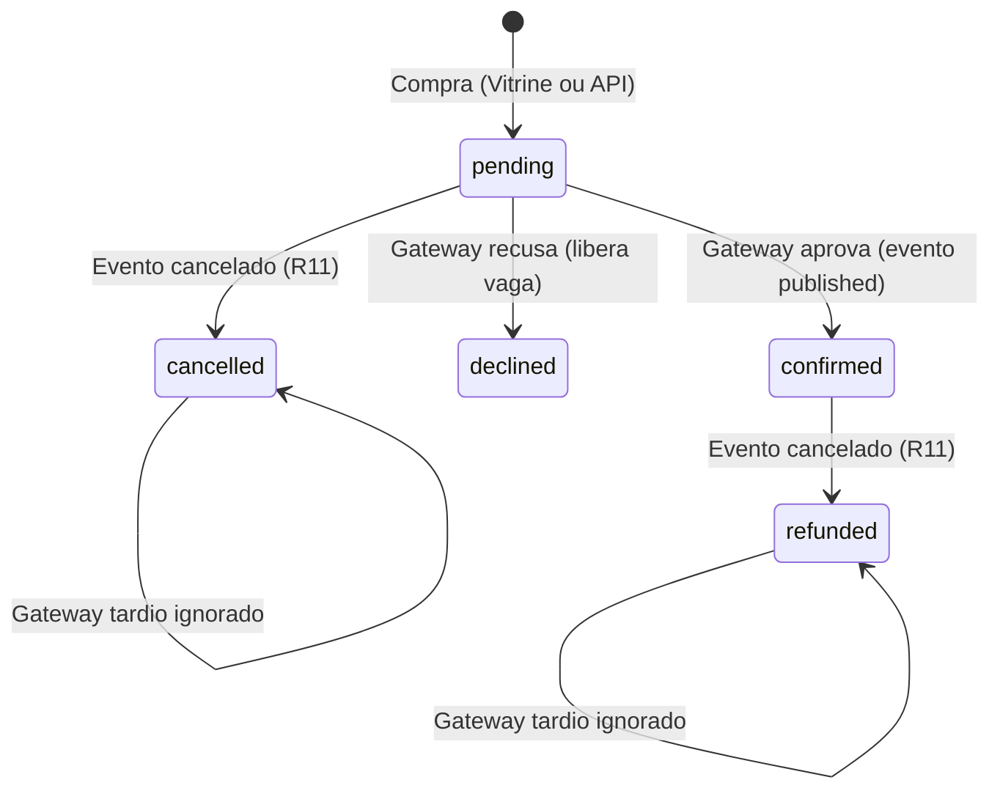

# FDD — Feature Design Document (Catraca MVP)

## 1. Modelo de Dados (PostgreSQL + Drizzle ORM)

### `users`
- `id`: `text` PK (ex.: `usr_...`)
- `name`: `text` NOT NULL
- `email`: `text` NOT NULL UNIQUE
- `password_hash`: `text` NOT NULL
- `role`: `text` NOT NULL (`'organizer' | 'participant'`)
- `created_at`: `timestamptz` DEFAULT NOW()

### `sessions`
- `id`: `text` PK (token aleatório hex 64 chars)
- `user_id`: `text` FK → `users.id` ON DELETE CASCADE
- `expires_at`: `timestamptz` NOT NULL
- `created_at`: `timestamptz` DEFAULT NOW()

### `events`
- `id`: `text` PK (ex.: `evt_...`)
- `organizer_id`: `text` FK → `users.id` NOT NULL
- `name`: `text` NOT NULL
- `starts_at`: `timestamptz` NOT NULL
- `location`: `text` NOT NULL
- `capacity`: `integer` NOT NULL CHECK (`capacity >= 1`)
- `price_cents`: `integer` NOT NULL CHECK (`price_cents > 0`)
- `status`: `text` NOT NULL (`'draft' | 'published' | 'cancelled'`) DEFAULT `'draft'`
- `created_at`: `timestamptz` DEFAULT NOW()
- `updated_at`: `timestamptz` DEFAULT NOW()

### `tickets`
- `id`: `text` PK (ex.: `tkt_...`)
- `code`: `text` NOT NULL UNIQUE (8 caracteres alfanuméricos maiúsculos sem ambiguidade, ex.: `K7Q2M9XA`)
- `event_id`: `text` FK → `events.id` NOT NULL
- `user_id`: `text` FK → `users.id` NULL (preenchido para compras da vitrine; `NULL` para compras via API de parceiros)
- `buyer_email`: `text` NOT NULL
- `channel`: `text` NOT NULL (`'web' | 'partner'`)
- `price_cents`: `integer` NOT NULL (preço vigente no momento da compra — R03/R12)
- `status`: `text` NOT NULL (`'pending' | 'confirmed' | 'declined' | 'cancelled' | 'refunded'`)
- `checked_in`: `boolean` NOT NULL DEFAULT `false`
- `checked_in_at`: `timestamptz` NULL
- `created_at`: `timestamptz` DEFAULT NOW()
- `updated_at`: `timestamptz` DEFAULT NOW()

### `api_keys`
- `id`: `text` PK
- `name`: `text` NOT NULL
- `key_hash`: `text` NOT NULL UNIQUE (SHA-256 hex da chave)
- `active`: `boolean` NOT NULL DEFAULT `true`
- `created_at`: `timestamptz` DEFAULT NOW()

---

## 2. Máquina de Estados

---

## 3. Contratos de Rotas

### API de Parceiros (Contrato Fixo — `X-Api-Key` obrigatório)
1. `GET /api/partner/events`
   - `401`: `{"error":"unauthorized"}`
   - `200`: `[{ "id": "evt_...", "name": "...", "startsAt": "ISO-8601", "priceCents": 10000, "availableSeats": 2 }]`
2. `POST /api/partner/events/{eventId}/purchases`
   - Ordem estrita de validação:
     1. `X-Api-Key` ausente/inválido → `401 {"error":"unauthorized"}`
     2. Corpo inválido (JSON inválido, `buyerEmail` mal formado, `cardNumber` diferente de `/^\d{16}$/`) → `422 {"error":"invalid_request"}`
     3. Evento inexistente, `draft` ou `cancelled` → `404 {"error":"event_not_available"}`
     4. Sem vaga disponível (`occupied >= capacity`) → `409 {"error":"sold_out"}`
     5. Sucesso → `202 {"ticketId":"tkt_...","code":"...","status":"pending"}`
3. `GET /api/partner/tickets/{ticketId}`
   - `401`: `{"error":"unauthorized"}`
   - `404`: `{"error":"ticket_not_found"}`
   - `200`: `{"ticketId":"...","code":"...","eventId":"...","status":"...","checkedIn":false}`

### Matriz de Precedência do Check-in (R10)
Dado `eventId` (do organizador autenticado) e `code`:
1. Não existe ingresso com `code` ou `ticket.eventId !== eventId` → `Ingresso inválido para este evento`
2. `event.status === 'cancelled'` → `Evento cancelado`
3. `ticket.status !== 'confirmed'` → `Ingresso não confirmado`
4. `ticket.checkedIn === true` → `Ingresso já utilizado`
5. Caso contrário → marca `checked_in = true`, `checked_in_at = NOW()` e retorna `Entrada liberada`

### Fórmulas do Painel de Gestão (R12)
- **Confirmados:** `COUNT(*) WHERE status = 'confirmed'` (inclui `checked_in = true`)
- **Pendentes:** `COUNT(*) WHERE status = 'pending'`
- **Check-ins:** `COUNT(*) WHERE status = 'confirmed' AND checked_in = true`
- **Vagas disponíveis:** `event.status === 'cancelled' ? 0 : Math.max(0, event.capacity - (confirmados + pendentes))`
- **Receita:** `SUM(price_cents) WHERE status = 'confirmed'` (formatado em `R$ X,XX`)
- **Estornados:** `COUNT(*) WHERE status = 'refunded'`
