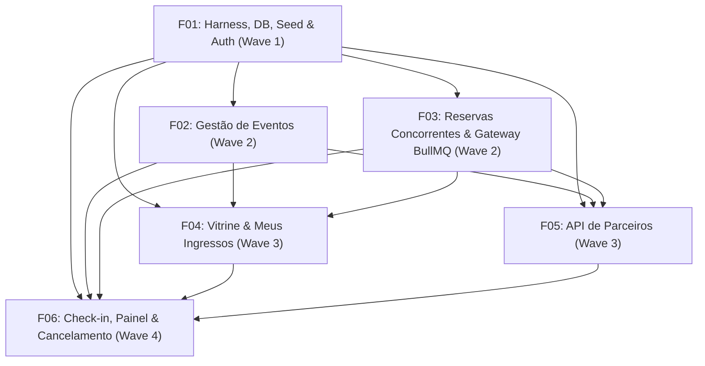

# PRD — Catraca MVP

## 1. Visão Geral
A **Catraca** é uma plataforma de venda de ingressos para eventos pequenos (shows em bar, workshops, meetups). Este PRD traduz integralmente o brief da fundadora (`brief.md`, regras **R01** a **R13**) em **6 features** conectadas por contratos explícitos (`Provides`/`Consumes`), grafo de dependências, **4 waves de entrega** (com **Wave 2** e **Wave 3** executadas em paralelo) e critérios de aceite por feature e cross-feature.

### Perfis de Uso
- **Visitante:** sem login, visualiza a vitrine pública de eventos publicados e não cancelados.
- **Participante:** cria conta (nome, e-mail, senha), entra, sai, compra ingressos na vitrine e acompanha seus ingressos em "Meus ingressos".
- **Organizador:** pré-cadastrado via seed (Organizador A e Organizador B); cria, edita, publica, cancela, faz check-in e vê o painel apenas dos próprios eventos.
- **Parceiro:** sistema externo autenticado pelo cabeçalho `X-Api-Key` na API de parceiros (`/api/partner/*`).

### Estados do Ingresso (UI ↔ API)
| Rótulo na UI | Valor na API | Significado |
| --- | --- | --- |
| `pendente` | `pending` | Compra criada, ocupa vaga, aguarda resposta do gateway |
| `confirmado` | `confirmed` | Gateway aprovou o pagamento |
| `recusado` | `declined` | Gateway recusou; vaga liberada |
| `cancelado` | `cancelled` | Estava `pending` quando o evento foi cancelado |
| `estornado` | `refunded` | Estava `confirmed` quando o evento foi cancelado |

> Check-in não é status: é um campo booleano independente (`checkedIn` na API, `checked_in` no banco).

---

## 2. Catálogo de Features (Provides & Consumes)

### `F01` — Plataforma, Harness, Banco de Dados, Seed e Autenticação
- **Wave:** 1
- **Consumes:** Nenhum (fundação do sistema).
- **Provides:**
  - `docker-compose.yml` com `postgres` (PostgreSQL 16), `redis` (Redis 7), `app` (Next.js App Router na porta `3000`) e `worker` (BullMQ worker).
  - Scripts de harness na raiz: `npm run up`, `npm run down`, `npm run gates`.
  - Schema Drizzle + migrations para `users`, `sessions`, `events`, `tickets`, `api_keys`.
  - Seed idempotente criando Organizador A, Organizador B, Participante padrão e chave de parceiro (`X-Api-Key`).
  - Autenticação por sessão HTTP-only (cadastro de participante, login, logout) e middleware/guards de autorização por perfil (`organizer`, `participant`) para base de **R13**.
  - Logger JSON estruturado com redação `[LGPD_REDACTED]` para e-mail, senha e número de cartão.

### `F02` — Gestão de Eventos e Área do Organizador
- **Wave:** 2 *(paralela com `F03`)*
- **Consumes:**
  - `F01`: Schema de `events`/`users`, sessão autenticada de organizador, guard RBAC (`requireOrganizer`), helper de logs.
- **Provides:**
  - Área `/organizer` listando exclusivamente os eventos do organizador autenticado (**R13**).
  - Criação de evento em rascunho (**R01**, **R02**) validando nome, data futura, local, lotação `>= 1` e preço `> 0`.
  - Página de gestão com URL própria `/organizer/events/[id]` (**R04**) com isolamento estrito de propriedade (**R13**).
  - Edição de evento validando data futura (**R01**), bloqueio de redução de lotação abaixo das vagas ocupadas (**R03**, **R05**) e alteração de preço válida apenas para compras futuras (**R03**).
  - Ação de publicação de rascunho (**R02**), tornando o evento elegível para vitrine e API de parceiros.

### `F03` — Motor de Reservas Concorrentes e Gateway Simulado Assíncrono (BullMQ)
- **Wave:** 2 *(paralela com `F02`)*
- **Consumes:**
  - `F01`: Schema de `events`/`tickets`, conexão PostgreSQL (`pg` + Drizzle), Redis/BullMQ, logger LGPD.
- **Provides:**
  - Função transacional `purchaseTicket(...)` com `SELECT ... FOR UPDATE` na linha do evento, validando cartão de 16 dígitos, evento publicado e não cancelado (**R02**), cálculo atômico de vagas ocupadas (`pending` + `confirmed`, **R05**), recusa `sold_out` quando lotado (**R07**), geração de código único do ingresso (**R09**) e snapshot de `price_cents` no momento da compra (**R03**, **R06**).
  - Enfileiramento imediato na fila BullMQ `payment-gateway` sem bloquear a resposta (**R06**).
  - Worker BullMQ do gateway simulado (finais `0001`: aprova 2–5s; `0002`: recusa 2–5s; `0003`: aprova 30–40s; `0004`: recusa 30–40s; demais: recusa 2–5s) atualizando status para `confirmed` ou `declined` (**R08**) com guarda condicional (`WHERE status = 'pending'`) para não sobrescrever ingressos já cancelados/estornados (**R11**).
  - Serviços de consulta de vagas disponíveis (**R05**) e consulta de ingresso por `ticketId` (**R09**).

### `F04` — Vitrine Pública e Área do Participante ("Meus Ingressos")
- **Wave:** 3 *(paralela com `F05`)*
- **Consumes:**
  - `F01`: Sessão de participante, cadastro/login/logout.
  - `F02`: Eventos publicados e não cancelados (**R02**).
  - `F03`: Serviço `purchaseTicket`, cálculo de `availableSeats` (**R05**), processamento assíncrono do gateway (**R06**, **R08**).
- **Provides:**
  - Vitrine pública `/` acessível a visitantes e participantes exibindo apenas eventos publicados e não cancelados (**R02**).
  - Fluxo de compra na vitrine para participante autenticado com exibição de `Ingressos esgotados` quando sem vaga (**R07**).
  - Página `/my-tickets` ("Meus ingressos") listando evento, rótulo de status em português (`pendente`, `confirmado`, `recusado`, `cancelado`, `estornado`) e código único de cada ingresso comprado pelo participante (**R09**).

### `F05` — API de Parceiros (Contrato Fixo)
- **Wave:** 3 *(paralela com `F04`)*
- **Consumes:**
  - `F01`: Tabela `api_keys`, middleware de validação `X-Api-Key`.
  - `F02`: Eventos publicados e não cancelados (**R02**).
  - `F03`: Serviço `purchaseTicket`, cálculo de `availableSeats` (**R05**), consulta de ingressos (**R09**).
- **Provides:**
  - `GET /api/partner/events`: lista eventos publicados e não cancelados com `id`, `name`, `startsAt`, `priceCents`, `availableSeats`.
  - `POST /api/partner/events/{eventId}/purchases`: valida na ordem exata `401 unauthorized` → `422 invalid_request` → `404 event_not_available` → `409 sold_out` → `202 { ticketId, code, status: "pending" }` (**R06**, **R07**).
  - `GET /api/partner/tickets/{ticketId}`: retorna ingresso de qualquer canal (vitrine ou API) com `ticketId`, `code`, `eventId`, `status`, `checkedIn`, ou `404 ticket_not_found`.

### `F06` — Check-in, Painel de Gestão e Cancelamento Irreversível
- **Wave:** 4
- **Consumes:**
  - `F01`: Sessão/RBAC de organizador (**R13**).
  - `F02`: Página de gestão `/organizer/events/[id]` (**R04**) e bloqueio de edição pós-cancelamento (**R11**).
  - `F03`: Estado dos ingressos, guarda do worker contra resposta tardia (**R11**) e preço histórico pago (`price_cents`).
  - `F04`: Ingressos comprados via vitrine refletidos no painel, check-in e cancelamento.
  - `F05`: Ingressos comprados via API de parceiros refletidos no painel, check-in e cancelamento.
- **Provides:**
  - Operação de Check-in na página de gestão com avaliação na ordem exata de **R10** (`Ingresso inválido para este evento` → `Evento cancelado` → `Ingresso não confirmado` → `Ingresso já utilizado` → `Entrada liberada`).
  - Painel de Gestão na página `/organizer/events/[id]` exibindo **Confirmados**, **Pendentes**, **Check-ins**, **Vagas disponíveis**, **Receita** (soma do preço vigente em cada compra confirmada) e **Estornados**, unificando vitrine e API (**R12**, **R03**, **R05**).
  - Cancelamento irreversível de evento publicado (**R11**): retira evento da vitrine e da API, bloqueia novas compras (`404 event_not_available`) e edições/republicações, transiciona em até 10s (imediatamente na transação) `confirmed` → `refunded` e `pending` → `cancelled`, garantindo imutabilidade frente a respostas tardias do gateway.

---

## 3. Grafo de Dependências e Waves

| Wave | Features | Modo de Execução |
| --- | --- | --- |
| **Wave 1** | `F01` | Sequencial (fundação) |
| **Wave 2** | `F02`, `F03` | **Paralela** (2 worktrees/branches simultâneas integradas via PRs) |
| **Wave 3** | `F04`, `F05` | **Paralela** (2 worktrees/branches simultâneas integradas via PRs) |
| **Wave 4** | `F06` | Sequencial (convergência operacional final) |

---

## 4. Critérios de Aceite por Feature

### F01 (Fundação, Harness, Seed e Auth)
- **AC-F01.1:** Em clone limpo, `npm run up` sobe Postgres, Redis, Next.js e Worker com migrations e seed aplicadas, deixando `$WEB` acessível sem passos adicionais.
- **AC-F01.2:** `npm run down` encerra todos os containers e libera todas as portas; executar `npm run up` novamente funciona sem erro (seed idempotente).
- **AC-F01.3:** `npm run gates` executa lint/typecheck e testes automatizados e passa na `main`.
- **AC-F01.4 (R13):** Participante pode criar conta (nome, e-mail, senha), entrar e sair; Organizador A e B entram com credenciais da seed; rotas `/organizer/*` bloqueiam visitantes e participantes.
- **AC-F01.5:** Logs de aplicação saem em JSON estruturado com `[LGPD_REDACTED]` para campos sensíveis (`password`, `cardNumber`, `email`).

### F02 (Gestão de Eventos)
- **AC-F02.1 (R01, R02):** Organizador cria evento com nome, data futura, local, lotação `>= 1` e preço `> 0`; o evento nasce em `draft`. Data no passado é rejeitada na criação e na edição.
- **AC-F02.2 (R02, R04):** Cada evento possui página de gestão própria `/organizer/events/[id]` onde o organizador pode editar e publicar o evento.
- **AC-F02.3 (R03, R05):** Reduzir lotação abaixo das vagas ocupadas (`pending` + `confirmed`) é rejeitado; aumentar lotação é aceito; alterar preço preserva o preço pago nas compras anteriores.
- **AC-F02.4 (R13):** Organizador B não vê eventos do Organizador A na lista nem ao acessar diretamente `/organizer/events/[id]` de A (nenhum dado do evento é exposto).

### F03 (Motor de Reservas & Gateway BullMQ)
- **AC-F03.1 (R05, R06, R09):** `purchaseTicket` cria ingresso `pending` com código único e `price_cents` vigente, ocupa 1 vaga imediatamente e retorna sem aguardar o gateway. Cartão diferente de 16 dígitos é rejeitado antes de criar o ingresso.
- **AC-F03.2 (R07):** Sob 30 compras simultâneas para evento de lotação 5 (em duas rodadas com eventos distintos), exatamente 5 são aceitas e 25 retornam `sold_out`, nunca excedendo a lotação.
- **AC-F03.3 (R08):** Worker BullMQ processa cartões simulados com latência padrão (`0001` aprova 2–5s, `0002` recusa 2–5s, `0003` aprova 30–40s, `0004` recusa 30–40s, outros recusam 2–5s); recusa libera a vaga.
- **AC-F03.4 (R11):** Atualização do worker só altera ingresso que ainda esteja `pending` em evento não cancelado, impedindo sobrescrita pós-cancelamento.

### F04 (Vitrine Pública e Meus Ingressos)
- **AC-F04.1 (R02):** Vitrine `/` exibe apenas eventos publicados e não cancelados; rascunhos não aparecem.
- **AC-F04.2 (R06, R08, R09):** Participante compra ingresso pela vitrine com cartão `4000000000000001`; o ingresso aparece em `/my-tickets` como `pendente`, passa a `confirmado` em até 5s e exibe evento, status e código.
- **AC-F04.3 (R07):** Quando `availableSeats === 0`, a vitrine exibe `Ingressos esgotados` (no lugar do botão de compra ou na tentativa).

### F05 (API de Parceiros)
- **AC-F05.1:** Todas as 3 rotas (`/api/partner/events`, `/api/partner/events/{eventId}/purchases`, `/api/partner/tickets/{ticketId}`) exigem `X-Api-Key` válido; ausente ou inválido retorna `401` com `{"error":"unauthorized"}`.
- **AC-F05.2 (R02, R05):** `GET /api/partner/events` retorna apenas eventos publicados e não cancelados com `id`, `name`, `startsAt`, `priceCents` e `availableSeats` exatos.
- **AC-F05.3 (R06, R07):** `POST /api/partner/events/{eventId}/purchases` valida na ordem `422 invalid_request` → `404 event_not_available` → `409 sold_out` → `202 { ticketId, code, status: "pending" }`.
- **AC-F05.4 (R09):** `GET /api/partner/tickets/{ticketId}` retorna `200` com `ticketId`, `code`, `eventId`, `status`, `checkedIn` para ingressos de qualquer canal (vitrine ou API) ou `404 ticket_not_found`.

### F06 (Check-in, Painel e Cancelamento)
- **AC-F06.1 (R10):** Na página de gestão, o check-in aplica a precedência exata e retorna as mensagens exatas: `Ingresso inválido para este evento`, `Evento cancelado`, `Ingresso não confirmado`, `Ingresso já utilizado`, `Entrada liberada`.
- **AC-F06.2 (R12, R03, R05):** O painel de gestão mostra **Confirmados**, **Pendentes**, **Check-ins**, **Vagas disponíveis**, **Receita** (somando `price_cents` vigente na compra de cada confirmado) e **Estornados**, refletindo vendas da vitrine e da API.
- **AC-F06.3 (R11):** Cancelar evento publicado é irreversível: remove da vitrine e da API, rejeita compras na API (`404 event_not_available`), bloqueia edição/republicação, converte `confirmed` → `refunded` e `pending` → `cancelled` em até 10s, e mantém esses estados após resposta tardia do gateway (ex.: cartão `0003` após 45s).

---

## 5. Critérios Cross-Feature (Cobertura 100% das Dependências do Grafo)

Cada aresta `Origem → Destino` do grafo de dependências possui pelo menos um critério cross-feature verificável:

| ID | Aresta | Regras | Critério Cross-Feature | Coberto no Contrato |
| --- | --- | --- | --- | --- |
| **XF-01** | `F01 → F02` | R01, R13 | Credenciais de Organizador A/B criadas pela seed (`F01`) autenticam na área `/organizer` (`F02`) e aplicam isolamento de propriedade por `organizerId`. | `F02` |
| **XF-02** | `F01 → F03` | R06, R08 | Containers Postgres/Redis e schema inicializados por `F01` permitem ao motor transacional e ao worker BullMQ (`F03`) reservar vagas e processar callbacks assíncronos sem configuração manual. | `F03` |
| **XF-03** | `F01 → F04` | R09, R13 | Conta de participante criada pelo fluxo de cadastro de `F01` autentica na vitrine e visualiza os próprios ingressos em `/my-tickets` (`F04`). | `F04` |
| **XF-04** | `F01 → F05` | — | Chave `X-Api-Key` gerada pela seed de `F01` autentica chamadas nas três rotas da API de parceiros (`F05`), rejeitando chaves inválidas com `401`. | `F05` |
| **XF-05** | `F01 → F06` | R13 | Guard RBAC de `F01` impede que Organizador B, participante ou visitante acesse check-in, painel ou cancelamento (`F06`) de evento do Organizador A via URL direta. | `F06` |
| **XF-06** | `F02 → F04` | R02 | Evento criado em rascunho em `F02` não aparece na vitrine (`F04`); ao ser publicado em `F02`, aparece imediatamente na vitrine (`F04`). | `F04` |
| **XF-07** | `F03 → F04` | R05, R06, R07, R08 | Compra pela vitrine (`F04`) aciona `purchaseTicket` + BullMQ (`F03`), nasce `pendente`, passa a `confirmado` em até 5s (`0001`) e exibe `Ingressos esgotados` quando `F03` esgota as vagas. | `F04` |
| **XF-08** | `F02 → F05` | R02, R03 | Evento publicado em `F02` aparece em `GET /api/partner/events` (`F05`) com `priceCents` e `availableSeats` corretos; rascunhos não aparecem e retornam `404 event_not_available` na compra. | `F05` |
| **XF-09** | `F03 → F05` | R05, R06, R07, R08 | Compras via API (`F05`) usam o motor atômico e worker de `F03`: 30 compras simultâneas em lotação 5 retornam exatamente `5x 202` e `25x 409 sold_out`; recusa (`0004`) libera vaga em `GET /api/partner/events`. | `F05` |
| **XF-10** | `F02 → F06` | R03, R04, R11 | Cancelamento em `F06` bloqueia edição/republicação na página de gestão de `F02`; alteração de preço em `F02` reflete apenas em novas compras na receita calculada por `F06`. | `F06` |
| **XF-11** | `F03 → F06` | R08, R11 | Cancelar evento com ingresso `pending` (cartão lento `0003`) em `F06` converte-o em `cancelled` e a resposta tardia do worker `F03` (após 45s) não reverte o status para `confirmed`. | `F06` |
| **XF-12** | `F04 → F06` | R09, R10, R11, R12 | Ingresso comprado na vitrine (`F04`) é validado no check-in (`F06`), contabilizado no painel (`F06`) e estornado/cancelado ao cancelar o evento (refletido em `/my-tickets`). | `F06` |
| **XF-13** | `F05 → F06` | R10, R11, R12 | Ingresso comprado via API (`F05`) é validado no check-in (`F06`), contabilizado no painel (`F06`) e, após cancelamento do evento, retorna `refunded`/`cancelled` em `GET /api/partner/tickets/{ticketId}` e `404 event_not_available` em novas compras. | `F06` |

---

## 6. Fora de Escopo
Conforme o brief oficial:
- Deploy em nuvem ou qualquer ambiente além do local (Docker Compose).
- Integração com gateway de pagamento real, envio de e-mails ou notificações push/SMS.
- Aplicativo mobile e refinamentos estéticos/visuais avançados.
- Cadastro de organizadores via interface (contas de organizador vêm exclusivamente da seed).
- Compra de mais de um ingresso por transação, mapa de assentos numerados, cancelamento ou transferência de ingresso pelo participante.
- Atualização em tempo real via WebSockets/SSE (recarregar a página para observar mudança de status é suficiente).
- Tratamento avançado de múltiplos fusos horários.
